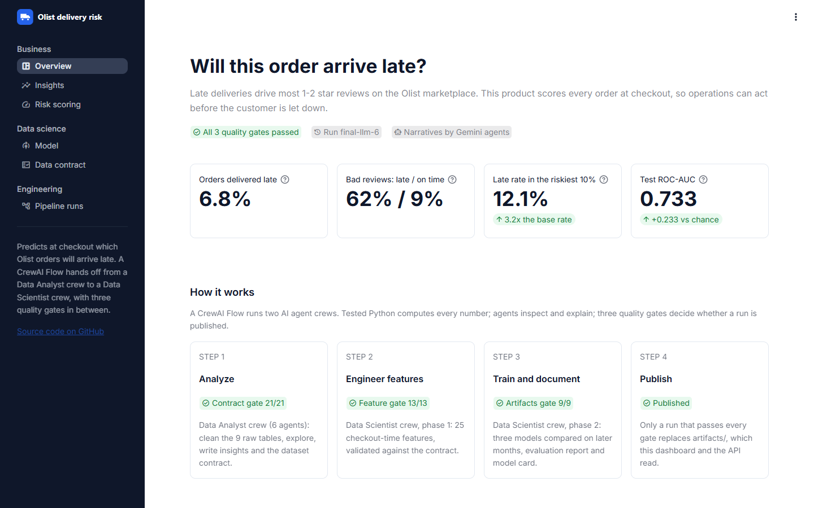
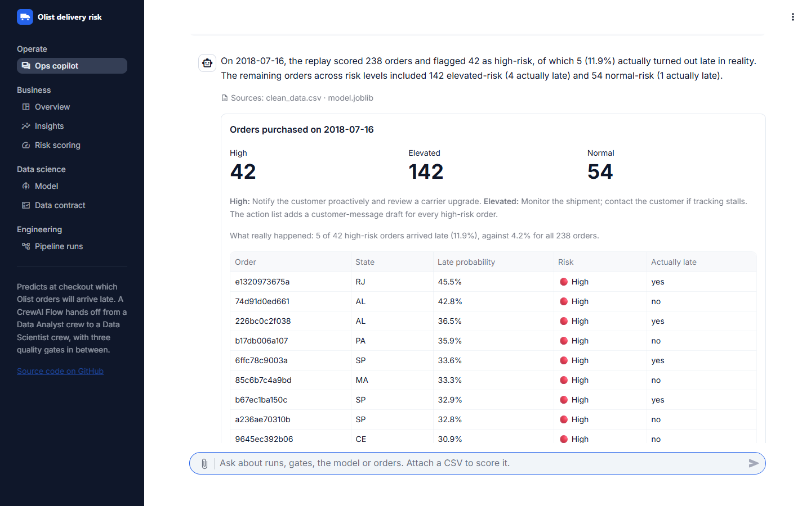
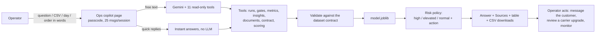
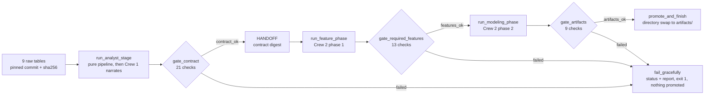

# Olist Late-Delivery AI Workflow (CrewAI Flow)

[](https://github.com/matnael332/pulse/actions/workflows/ci.yml)

An industry-style AI product workflow: a **CrewAI Flow** hands off from a **Data Analyst crew** to a
**Data Scientist crew** on the Olist Brazilian e-commerce dataset, with deterministic validation gates,
graceful failure and byte-reproducible artifacts.

**Business question.** Which orders will be delivered late, predicted at checkout? Among delivered
orders, **62.4%** of late orders get a 1-2 star review versus **9.2%** of on-time orders, so flagging
risky orders early protects customer satisfaction.

| | |
|---|---|
| What happened (Crew 1) | 99,441 orders; 96,203 delivered orders analysed; **6.8% delivered late**; median delivery 10 days vs 24 promised; Black Friday 2017-11-24 had 1,176 orders (next busiest day: 499) |
| What will happen (Crew 2) | Logistic regression selected over gradient boosting and a baseline; test **ROC-AUC 0.733**, PR-AUC 0.102 (baseline 0.038); the riskiest 10% of orders are late **12.1%** of the time, **3.2x** the 3.8% test late rate |
| The product | **Ops copilot**: a chat for the team that operates the agents, plus a dashboard and an API. **Live: [olist-late-delivery-1.streamlit.app](https://olist-late-delivery-1.streamlit.app)** (Streamlit Community Cloud; the copilot needs a passcode). Locally: `uv run streamlit run frontend/streamlit_app.py`; deployment in [docs/deploy.md](docs/deploy.md); API contract in [docs/api.md](docs/api.md) |
| Documentation | [architecture](docs/architecture.md), [decision records](docs/decisions.md), [interactive Flow diagram](docs/flow_plot/pulse_flow.html) |
| Presentation and video | [slides (PDF)](docs/presentation.pdf), [PowerPoint](docs/presentation.pptx) (12 slides, rebuilt from `artifacts/` by `scripts/build_presentation.py`), [video script](docs/video_script.md) |



## The product: Ops copilot

**Who uses it.** The data team that operates the agents. Instead of reading logs and JSON, they
ask in plain language (any language) in a WhatsApp-style chat inside the dashboard:

- *How did the last run go?* The status, the three gates (21/21, 13/13, 9/9), 12 LLM calls.
- *Replay 2018-07-16.* 238 orders ranked by risk: 42 high, 142 elevated, 54 normal. Because the
  day is in the past, the copilot shows what really happened: 5 of the 42 high-risk orders
  arrived late (11.9%) against 4.2% for the whole day.
- *Why are orders to Bahia riskier?* Answered from the analysts' numbers, with sources.
- A CSV of orders attached to the chat comes back as a ranked list and an action list with a
  customer-message draft for every high-risk order.





**How it stays trustworthy.**
- The copilot is read-only: it never runs, changes or deletes anything.
- Every number comes from a tool. The **Sources** line is built from the tool calls, and any
  percentage the tools did not return is flagged.
- Quick replies answer instantly without an LLM, and the chat keeps working when Gemini is down.
- One risk policy (`backend/pulse_api/risk.py`) drives the chat, the dashboard and the API:
  **high** is the riskiest 10% (probability >= 0.1698), **elevated** is above the decision
  threshold (0.055), and the rest are **normal**.
- The same scoring is an API for other systems: `POST /predict`, `POST /predict/batch` (CSV,
  partial success) and `GET /risk-list` (a replayed day). See [docs/api.md](docs/api.md).

## Architecture



**Run-then-narrate.** Each Flow stage first runs a seeded, unit-tested Python step (`pulse_core`,
no LLM) that writes every artifact. Only then does the crew run: tool-bearing agents inspect the
computed results through read-through tools, and tool-less narrator agents write structured
narratives (`output_pydantic`) grounded in those numbers. Gates never depend on LLM behaviour, and
in deterministic mode (`--no-llm`) template narratives make every artifact spec-complete.

| Crew | Agents | Produces |
|---|---|---|
| **Data Analyst crew** (`backend/pulse_flow/crews/data_analyst`) | Senior Data Engineer, Data Documentation Writer, Retail Analytics Lead, Business Insights Writer, Data Governance Steward, Data Contract Author | `clean_data.csv`, `eda_report.html`, `insights.md`, `dataset_contract.json` |
| **Data Scientist crew** (`backend/pulse_flow/crews/data_scientist`) | ML Feature Engineer, Feature Reviewer, ML Engineer, Model Reviewer, Model Card Author | `features.csv`, `model.joblib`, `evaluation_report.md`, `model_card.md` |

The Data Scientist crew is one CrewAI class run in two phases, so the Flow's
"required features exist before modeling" gate sits between feature engineering and training. The
contract digest (version, sha256, row count, target, required and forbidden features, split policy)
is passed to the scientist agents, and the contract hash is recorded in `feature_spec.json`,
`model_meta.json` and `model_card.md`; `gate_artifacts` checks they all agree.

## Spec compliance map

| Requirement (course spec) | Where |
|---|---|
| Crew 1 with >= 3 agents | 6 agents, `backend/pulse_flow/crews/data_analyst/config/agents.yaml`; test `backend/tests/test_crews.py` |
| Ingest and validate a public dataset | `scripts/download_data.py` (pinned commit, sha256 manifest, raw schema check), `check_inputs` step |
| Clean, preprocess, document | rules R1-R10 in `backend/pulse_core/cleaning/rules.py`; `artifacts/cleaning_report.md` |
| Descriptive analytics, EDA, visual insights, business summaries | `artifacts/eda_report.html` (7 figures, two layers), `artifacts/insights.md` |
| Dataset contract (schema, allowed values, assumptions, constraints) | `artifacts/dataset_contract.json` |
| Crew 2 with >= 3 agents | 5 agents, `backend/pulse_flow/crews/data_scientist/config/agents.yaml` |
| Read and validate cleaned data + contract | `validate_inputs` tool (first step of `feature_task`); recorded in `feature_spec.json["input_validation"]` |
| Feature engineering | 25 checkout-time features, `backend/pulse_core/features/`; `artifacts/features.csv` |
| Train >= 1 model, compare >= 2 variations | baseline + logistic regression + gradient boosting, `backend/pulse_core/modeling/`; `artifacts/metrics.json` |
| Model card: purpose, training data, metrics, limitations, ethics | `artifacts/model_card.md` (sections checked by `gate_artifacts`) |
| Outputs `features.csv`, `model.pkl/.joblib`, `evaluation_report.md`, `model_card.md` | `artifacts/` |
| Flow automates the handoff | `backend/pulse_flow/flow.py`; log line `HANDOFF analyst->scientist ...` |
| Validation: contract matches the cleaned dataset | `gate_contract`, `backend/pulse_core/validators/contract_gate.py` |
| Validation: required features exist before modeling | `gate_required_features`, `backend/pulse_core/validators/features_gate.py` |
| Deterministic steps | seeds, pinned threads, stable sorts, LF writers; CI job `verify-repro` |
| Clear logging | `artifacts/logs/pipeline.log` (STAGE / GATE / HANDOFF / CREW / TOOL / LLM lines), crew transcripts, `run_manifest.json` |
| Artifacts saved inside the repo | `artifacts/` (promoted by directory swap); CI job `verify-artifacts` |
| Fail gracefully | `fail_gracefully` step, 7 injectable faults, `backend/tests/test_flow.py` |
| Git + GitHub with PRs | one PR per milestone, protected `main`, required CI check |
| Streamlit and Flask | `frontend/` (dashboard), `backend/pulse_api/` (prediction API) |
| Pandas, scikit-learn, matplotlib/seaborn | `backend/pulse_core` |

## Verify in 10 minutes

```bash
git clone https://github.com/matnael332/pulse && cd pulse
uv sync                                                     # Python 3.13 + locked dependencies
uv run python -m pulse_core.validate artifacts              # the 3 gates on the committed artifacts
uv run pytest                                               # 164 tests, no LLM calls (~2 min)
uv run python -m pulse_flow.run --no-llm --data-dir backend/tests/fixtures/olist_mini --no-promote
uv run python -m pulse_flow.run --no-llm --data-dir backend/tests/fixtures/olist_mini --no-promote \
    --inject-fault missing_feature                          # graceful failure: exit 1, nothing promoted
uv run python -m pulse_flow.run verify-repro --data-dir backend/tests/fixtures/olist_mini
uv run streamlit run frontend/streamlit_app.py              # dashboard
```

## Run the full pipeline

```bash
uv run python scripts/download_data.py      # 9 CSVs (~126 MB) from Olist's GitHub, sha256-verified
cp .env.example .env                        # set GEMINI_API_KEY (Google AI Studio)
uv run kickoff                              # LLM mode: both crews on Gemini, ~3 minutes, ~12 calls
uv run python -m pulse_flow.run --no-llm    # deterministic mode, ~2 minutes
uv run pulse-api                            # prediction API on http://127.0.0.1:8000
curl -s -X POST http://127.0.0.1:8000/predict -H "Content-Type: application/json" \
    -d @backend/pulse_api/examples/order.json   # two orders; invalid_order.json returns 422
```

On Windows PowerShell use `curl.exe` and quote the file argument: `-d "@backend/pulse_api/examples/order.json"`.

| Flag | Meaning |
|---|---|
| `--no-llm` / `--mode` | deterministic or LLM mode (default: LLM when `GEMINI_API_KEY` is set) |
| `--data-dir` | folder with `raw/` and `lookups/` (default `data`; fixture `backend/tests/fixtures/olist_mini`) |
| `--inject-fault NAME` | `bad_input_hash`, `crew_error`, `drop_column`, `contract_mismatch`, `missing_feature`, `leaky_feature`, `missing_artifact` |
| `--no-promote` | keep the run in `runs/<id>/` only |
| `--from-run ID --start-at features\|modeling` | resume from a previous run's artifacts |
| `--compare-to DIR` | print the reproducibility table against another artifacts folder |
| `--model ID` | Gemini model (default `gemini-3.5-flash-lite`) |

**Exit codes:** 0 success; 1 graceful failure (see `runs/<id>/run_status.json`); 2 unexpected
error (redacted traceback in `runs/<id>/traceback.txt`); 3 download hash mismatch (download script).

## Failure policy

| Event | Run status / stage | Exit | Promoted? |
|---|---|---|---|
| Raw file missing, hash mismatch or schema change | failed / `check_inputs` | 1 | no |
| A deterministic stage raises | failed / that stage | 1 | no |
| Gemini quota exhausted (429) after retries | failed, `quota exhausted: ...` | 1 | no |
| Other LLM problem (empty or invalid structured output) | success with `narrative_degraded` warning, template text | 0 | yes |
| A gate fails | failed / `gate_*`, error prefixed with the gate name | 1 | no |
| Promotion swap fails (file locked) | `promotion_failed`, previous `artifacts/` kept | 1 | rolled back |

## Reproducibility

Every data artifact is produced by seeded Python with pinned thread counts, stable sorts and
UTF-8/LF writers, so two runs produce identical bytes. `verify-repro` runs the pipeline twice in
fresh interpreters with different `PYTHONHASHSEED` values and compares everything; CI runs it on
Linux on every pull request. The LLM run that produced the committed artifacts was compared with a
deterministic run: all data artifacts identical, only the narrative text differs.

| Artifact | Guarantee |
|---|---|
| `clean_data.csv`, `features.csv`, `metrics.json`, `predictions_test.csv`, `eda_summary.json`, `cleaning_report.json` | byte-identical |
| `dataset_contract.json`, `feature_spec.json`, `model_meta.json` | identical apart from narrative blocks |
| figures, `eda_report.html` | identical on the same machine |
| `model.joblib` | compared through its predictions |
| narratives (`insights.md`, reports, model card) | identical in deterministic mode; LLM text varies, numbers come from code |

## Repository layout

The repository is a monorepo with one uv project at the root. The backend produces the artifacts;
the frontend only reads them. `artifacts/` is the contract between the two.

```
backend/                 Python backend (pipeline + prediction service)
  pulse_core/            pure data + ML library (no CrewAI): download, cleaning, EDA, contract,
                         validators, features, modeling, reporting, promotion, manifest, paths
  pulse_flow/            CrewAI layer: flow.py, crews/ (YAML + classes), tools/, events.py, run.py (CLI)
  pulse_api/             Flask prediction API: risk policy, batch scoring, daily replay (docs/api.md)
    examples/            order.json (200) and invalid_order.json (422) request bodies
  pulse_copilot/         Ops copilot: read-only tools, the Gemini loop, instant answers
  tests/                 backend tests + the olist_mini fixture (real subset with injected defects)
frontend/                Streamlit dashboard (reads artifacts/ only; Community Cloud entrypoint)
  streamlit_app.py       entrypoint and navigation
  views/                 one module per page (copilot.py is the Ops copilot chat)
  services/              cached artifact loading, scoring, the chat session
  tests/                 AppTest suite against the committed artifacts
  requirements.txt       slim deploy dependencies (no CrewAI), exported from uv.lock
artifacts/               the last promoted run (committed): the 8 spec files + reports, figures, logs
data/                    raw/ manifest and schema (CSVs are downloaded), lookups/, NOTICE.md
docs/                    architecture, decision records, deployment guide, slides, video script
scripts/                 data download, repo hygiene check, slide deck build and PDF export
```

## Data license

Data: Brazilian E-Commerce Public Dataset by Olist (GitHub `olist/work-at-olist-data`, MIT; Kaggle
listing CC BY-NC-SA 4.0). This is non-commercial coursework; see `data/NOTICE.md`. Code: MIT
(`LICENSE`).
