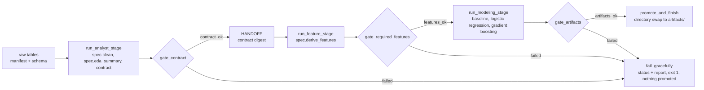

# pulse

A factory for trustworthy prediction models. A **CrewAI Flow** hands off from a **Data Analyst
crew** to a **Data Scientist crew** with deterministic validation gates in between, graceful
failure and byte-reproducible artifacts. The dataset is not part of the core: a `DatasetSpec`
supplies the raw schema, the cleaning rules, the column catalogue, the features, the target and
the split windows, and the pipeline turns it into a validated clean table, a dataset contract, a
model, metrics, a model card and an evaluation report.

**Status.** The Olist coursework content has been removed and the core is dataset-agnostic. No
real dataset spec exists yet; `backend/tests/toy_spec.py` is a small seeded spec that exercises
every gate, fault, renderer, the API and the ops copilot end to end. Next steps, in order: the
schema of the ten data groups, a synthetic data generator, the first real spec (account-month
churn), a Docker package for an on-premises pilot.

## How it runs



**Run-then-narrate.** Each stage first runs seeded Python that writes every artifact with template
narratives. Only then (in LLM mode) does a crew run: tool-bearing agents read the computed results
and tool-less narrator agents write structured narratives grounded in those numbers. Gates never
depend on LLM behaviour; `--no-llm` makes every artifact spec-complete without a model call.

**The seam.** Producers (`stages`, the contract builder, the feature builder, the Flow, the crew
runner) receive the `DatasetSpec`. Gates, training, fault injection and the raw loader read
everything they need from the artifacts: `feature_spec.json` carries the id, time and split
columns and the decision stage; `dataset_contract.json` carries the feature rules and the split
windows. See `backend/pulse_core/spec.py` for the full interface and the conventions a spec must
honour.

## Verify

```bash
uv sync                                                            # Python 3.13 + locked deps
uv run ruff check . && uv run ruff format --check .
uv run pytest                                                      # 73 tests on the toy spec
uv run python -m pulse_flow.run --no-llm --spec tests.toy_spec:SPEC --data-dir <toy data> --no-promote
uv run python -m pulse_flow.run --no-llm --no-promote               # no spec: graceful failure, exit 1
uv run streamlit run frontend/streamlit_app.py                     # dashboard (empty until a run is promoted)
uv run pulse-api                                                   # prediction API on http://127.0.0.1:8000
```

The toy data folder is written by `tests.toy_spec.write_raw(<dir>/raw)`; the test suite does this
in a temporary directory.

| Flag | Meaning |
|---|---|
| `--spec pkg.module:ATTR` | the dataset spec (default: the `PIPELINE_DATASET_SPEC` variable) |
| `--no-llm` / `--mode` | deterministic or LLM mode (default: LLM when `GEMINI_API_KEY` is set) |
| `--data-dir` | folder with `raw/` (tables, `raw_schema.json`, `manifest.json`) and `lookups/` |
| `--inject-fault NAME` | `bad_input_hash`, `crew_error`, `drop_column`, `contract_mismatch`, `missing_feature`, `leaky_feature`, `missing_artifact` |
| `--no-promote` | keep the run in `runs/<id>/` only |
| `--from-run ID --start-at features\|modeling` | resume from a previous run's artifacts |
| `--compare-to DIR` | print the reproducibility table against another artifacts folder |

**Exit codes:** 0 success; 1 graceful failure (see `runs/<id>/run_status.json`); 2 unexpected
error (redacted traceback in `runs/<id>/traceback.txt`).

## Repository layout

```
backend/
  pulse_core/        generic pipeline library (no CrewAI): spec, splits, columns, raw, contract,
                     validators (3 gates), features, modeling, reporting, promotion, manifest
  pulse_flow/        CrewAI layer: flow.py, crews/ (YAML + classes), tools/, run.py (CLI)
  pulse_api/         Flask prediction API: record validation from feature_spec.json, risk policy,
                     batch scoring
  pulse_copilot/     Ops copilot: read-only tools, the Gemini loop, instant answers
  tests/             tests + toy_spec.py (the synthetic DatasetSpec they run on)
frontend/            Streamlit dashboard (reads artifacts/ only): copilot, model, contract, runs
scripts/             repository hygiene check
```

`artifacts/` is the contract between the backend and the frontend: it holds the last promoted
run and is empty until one exists. Code: MIT (`LICENSE`).
